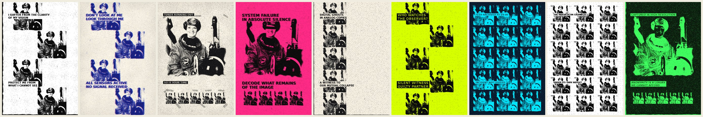
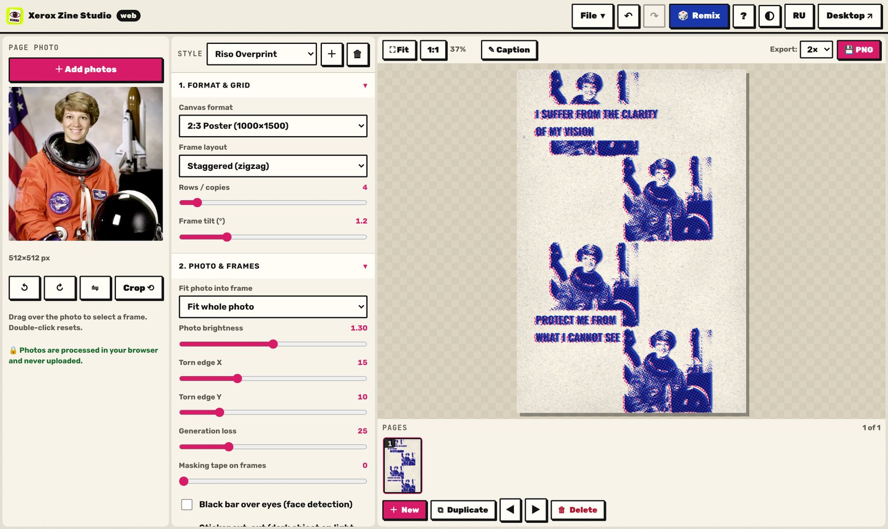

<div align="center">

# Xerox Zine Studio

**Turn photos into photocopied zine pages.**<br>
Halftone · torn edges · generation loss · riso overprint · paper grain · tape

[**Open in the browser →**](https://dmitrylelee.github.io/xeroxstudio/app/) · [Landing page](https://dmitrylelee.github.io/xeroxstudio/) · [Windows builds](https://github.com/DmitryLeLeE/xeroxstudio/releases)

English · [Русский](README.ru.md)



</div>

A zine is not a product, it is a gesture. This tool makes the gesture cheap: drop in a photo, pick a mood,
print the sheet, fold it, cut along the red line, give it to someone. It exists in two forms that share one
engine design, one preset library and one project format:

| | Web | Windows |
|---|---|---|
| Where | any modern browser, phone / tablet / desktop | Python 3.11–3.13 + Tkinter, `.exe` |
| Install | none; optional PWA, works offline | `python build.py` or a release download |
| Source | [`web/`](web) (vanilla JS, no build step) | repository root |
| Photos | processed locally, never uploaded | processed locally |



## What it does

- **Real halftone.** Amplitude screen with angle and dot size, Floyd–Steinberg grain, hard 1-bit stencil, toner noise, scanner streaks, copier edge shadow, ink misregistration.
- **Riso overprint.** A second ink layer on another screen angle, shifted and multiplied over the first. Nine paper / ink pairs plus your own colours.
- **Paper and tape.** Fibre and blotch texture, edge vignette, torn tape strips that get photocopied along with the page.
- **Generation loss.** Four layouts (staggered, column, contact sheet, hero + copies); every next copy is blurrier and harsher.
- **Manifestos.** 54 built-in English manifestos in eight categories, search, your own texts, three backings (box, Dymo tape, outline), draggable caption.
- **Faces.** Optional black bar over the eyes and sticker cut-outs (Haar cascade; runs in-browser too).
- **Print-ready.** PNG up to 3×, book PDF, A4 PDF with margins, **8-page mini-zine** with fold and cut lines, 1-bit PNG for stencil printing.
- **Projects.** `.zine` files (a zip with `manifest.json` and PNGs) open in both versions. Autosave, undo / redo.
- **Nine presets.** Classic Xerox, Newsprint, Acid Riot, Punk Flyer, Cyanotype, 35 mm Contact Sheet, Night Vision, Riso Overprint, Tape Collage — or save your own.

## Run it

**Browser:** <https://dmitrylelee.github.io/xeroxstudio/app/> — or locally:

```
python -m http.server -d web 8000     # then open http://localhost:8000/app/
```

**Windows, from source:**

```
pip install -r requirements.txt
python main.py                  # optionally pass a .zine or a photo
```

**Build the exe** (on Windows):

```
python build.py                 # dist\XeroxZineStudio.exe, tests + self-test included
python build.py --onedir        # folder + zip: faster start, fewer antivirus false positives
python build.py --installer     # + Inno Setup installer (winget install JRSoftware.InnoSetup)
```

Pushing a tag like `v1.1.0` builds the exe, zip and installer on GitHub Actions and attaches them to a Release.

## Project layout

```
engine.py  presets.py  config.py  manifestos.py   rendering core, presets, constants, manifesto library
main.py  ui_components.py  manifest_dialog.py     Tkinter interface
project_io.py  pdf_writer.py                      .zine files, own PDF writer
web/                                              the browser version (landing at /, app at /app/)
tools/gen_config_js.py  tools/gen_sw.py           keep web/ in sync with the Python constants, rebuild offline cache
tests/  tests/web/                                pytest suite (engine, presets, projects, PDF, web sync) and Playwright browser tests
docs/                                             screenshots and the .zine format
```

The web app reads its constants from `web/app/js/config.js`, which is **generated** from `config.py`, `presets.py`
and `manifestos.py`. After changing any of them run `python tools/gen_config_js.py`; after changing any site file run
`python tools/gen_sw.py`. `pytest` fails if either is stale.

## Tests

```
python -m pytest -q tests                      # browser tests are skipped without Playwright
pip install playwright && python -m playwright install chromium   # to run tests/web too
```

## Changelog and licenses

See [CHANGELOG.md](CHANGELOG.md). Code is [MIT](LICENSE); bundled fonts (SIL OFL) and the face model (Intel
licence) are listed in [THIRD_PARTY_NOTICES.md](THIRD_PARTY_NOTICES.md). The sample portrait is a NASA photograph
(public domain).
